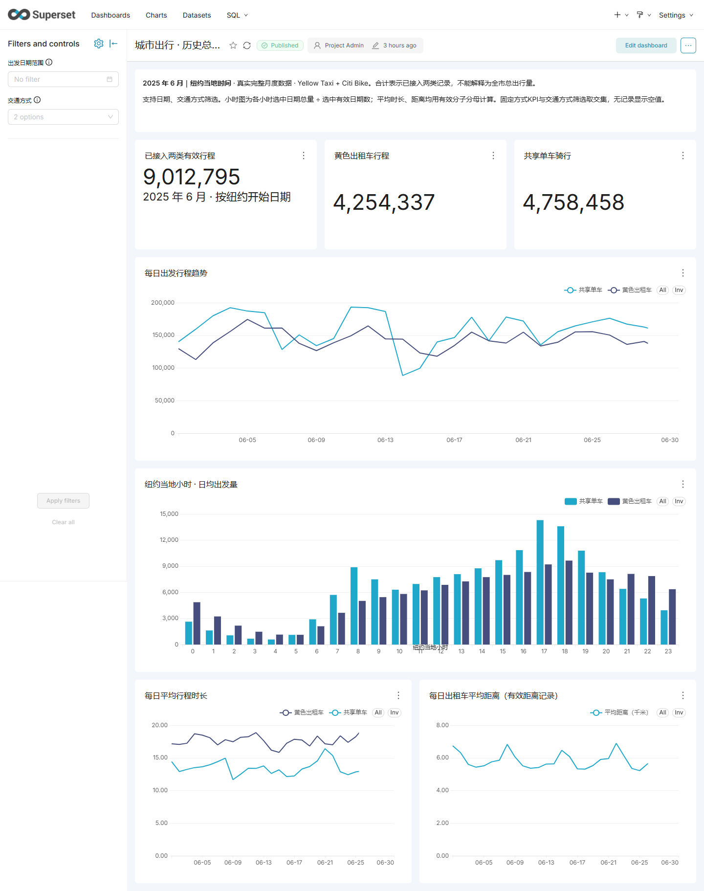
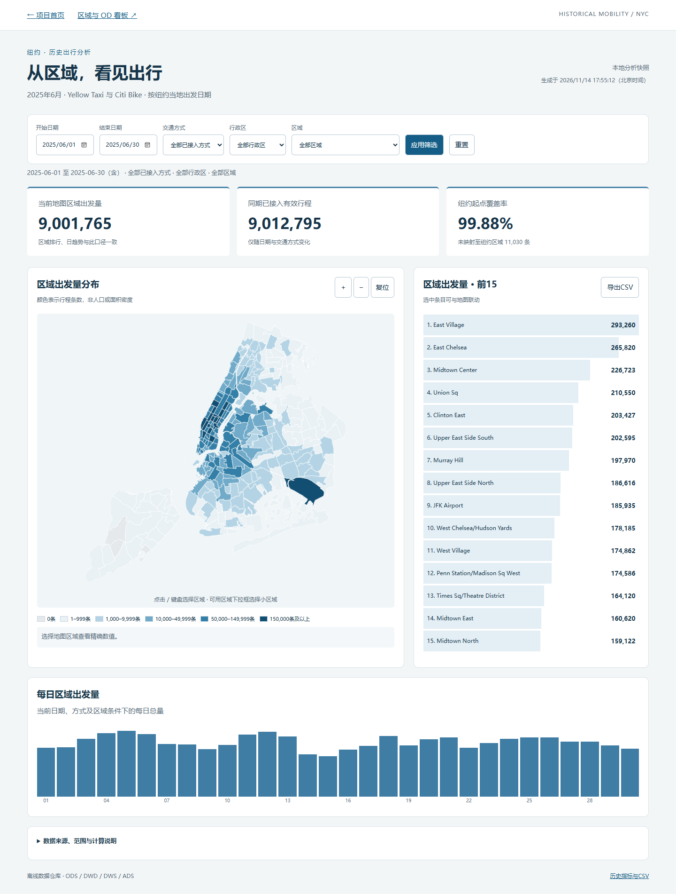
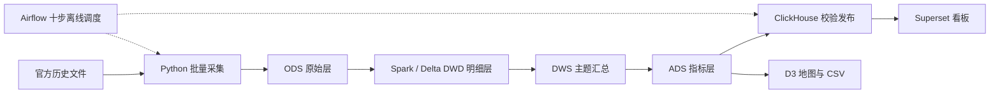

# 城市出行离线数仓系统

基于纽约 **2025 年 6 月** Yellow Taxi、Citi Bike、NOAA 日天气及出租车区域数据，完成采集、分层建模、质量校验、地图分析与任务调度的课程项目。

> 本仓库保存源码、设计文档、展示数据与历史验收记录。组员需要直接运行完整项目时，请使用另行分发的 Windows 64 位完整运行包；仅克隆本仓库不会得到完整数据、Docker 镜像或数据库备份。

## 2026-11-18 主题分析与建模整改

本轮完成三个分析主题下的12个业务问题、Kimball四步事实设计、业务总线矩阵、概念/逻辑/物理表达、分层职责与指标复核，以及开发生命周期追溯。保留两个事务事实和7个维度的既有粒度与物理命名，明确逻辑DIM与事实星座。

- [本轮交付入口](outputs/2026-11-18-theme-definition-e721eb90/交付入口.html)
- [正式项目报告](docs/20-城市出行离线数仓项目报告.md) · [14页PDF](outputs/2026-11-18-theme-definition-e721eb90/report/城市出行离线数仓项目报告.pdf) · [报告HTML](outputs/2026-11-18-theme-definition-e721eb90/report/城市出行离线数仓项目报告.html)
- [三大主题、12问与12组图表](outputs/2026-11-18-theme-definition-e721eb90/analysis/index.html) · [分析文字稿](docs/18-三个主题的数据分析结论.md) · [11项整改清单](outputs/2026-11-18-theme-definition-e721eb90/整改完成清单.md)
- [模型与总线矩阵](docs/15-业务总线矩阵与概念逻辑物理模型.md) · [分层/指标复核](docs/16-分层职责与指标口径复核.md)
- [官方HTML/XML目录爬取实现与实际发现回执](docs/19-官方数据爬取与采集说明.md)
- [综合验证：35项回归、16项模型核对、25个引用检查、12项分析对账及离线数据/页面核查](outputs/2026-11-18-theme-definition-e721eb90/verification/整改验证.json)

HTML须下载/克隆后用浏览器打开。分析页包含9份结果CSV和12组SVG/PNG；固定输入版本及文件SHA见同目录 `source-provenance.json`。主题定义页保留前期需求基线，实施结果以新报告和分析为准。

当前原机Docker因Windows安装注册信息缺失未能启动；本轮没有新的服务全链路验收。2026-11-14验收记录只说明当时情况。本轮按最新范围交付报告、必要验证及GitHub同步，不制作PPT、录屏或新的运行包；下文运行包说明描述此前交付。

复核工具依赖见 `requirements-review.txt`：

```powershell
python -m pip install -r requirements-review.txt
python -m unittest discover -s tests -v
python tools/verify_model_design.py
python tools/build_project_report.py
```

以上测试、模型检查、报告HTML生成无需启动Docker。导出PDF可加 `--pdf`，需要已安装Microsoft Edge；页面回归可运行 `python tools/verify_review_pages.py`。重建数据分析需要原项目完整的已固定Delta数据；仓库只有样例及公开结果。只发现官方目标链接可运行 `python tools/ingest_sources.py --month 2025-06 --discover-only`，不会下载大型行程文件或改写ODS。

## 项目效果




有效行程共 **9,012,795** 条，其中出租车 4,254,337 条、共享单车 4,758,458 条。总量仅表示已接入的两类记录，不代表全市全部出行。

- 7 个维度、2 张行程事实表、5 张 DWS 汇总表、7 张 ADS 指标表。
- 4 个 Superset 看板、19 张图表，覆盖总览、区域与 OD、天气、数据质量。
- 262 个地图区域，支持日期、出行方式、行政区和区域筛选及 CSV 导出。
- Airflow 串联 10 步离线任务，每天北京时间 02:00 执行，每 5 分钟检查运行状态。
- 使用发布版本、校验与复跑机制，保留数据来源和加工记录。

## 技术栈

| 组件 | 项目使用版本 | 用途 |
| --- | --- | --- |
| Spark / Delta Lake | 4.0.5 / 4.0.1 | 批处理、分层表与版本追溯 |
| ClickHouse | 25.8 | ADS 指标查询与校验发布 |
| Airflow | 3.3.2 | 调度、依赖、重试与监控 |
| Superset | 6.1.0 | 看板与多维筛选 |
| PostgreSQL | 17 | 调度与 BI 元数据库 |
| Docker Compose、Python、D3.js | 见代码与依赖文件 | 服务部署、采集与地图 |



## 查看成果

下载或克隆仓库后，可直接用浏览器打开 `outputs/项目总入口.html`、`outputs/map/map.html`、`outputs/dwd/六月数据清洗结果.html`；CSV 与架构图也可以离线查看。GitHub 文件预览不会执行 HTML 和地图脚本，需要先下载到本地。

已停止的运行状态页面只代表报告生成时的结果，不是云端在线服务。页面中的 `localhost` 链接需要本机启动完整服务。

## 在组员电脑运行

使用组内分发的完整运行包（约 10.64 GiB），包含数据、5 个 Docker 镜像、数据库备份、Docker 安装程序及内置 Python。解压后按包内说明操作：安装并启动 Docker Desktop → `01-first-install.cmd` → `02-start.cmd` → `06-open-dashboard.cmd`。

建议 Windows 10/11 x64、16GB 内存、至少 50GB 可用磁盘。密码通过组内说明另行提供，仓库中没有真实凭据。

## 源码开发

源码目录中的 Windows 脚本保留了原项目的本机路径设置。开发者需根据自己的 Docker、Python 和缓存位置调整相关路径；初始化本地凭据可运行 `python tools/init_local_config.py`。该命令不会覆盖已有配置。

两个自建镜像定义位于 `build/spark` 和 `build/superset`。仅启动空的 Compose 服务不会自动恢复已有业务表和看板，完整演示请使用组员运行包；从零重建还需准备 Python 依赖、官方源数据及加工环境。详细加工步骤见文档。

## 目录

| 目录 | 内容 |
| --- | --- |
| `jobs/`、`sql/` | 分层处理任务和表定义 |
| `tools/` | 采集、建模、发布、验收、调度执行器 |
| `dags/` | Airflow DAG |
| `config/`、`build/` | 非敏感配置与镜像构建定义 |
| `docs/` | 需求、指标口径、数据字典、架构图与验收范围 |
| `web/`、`outputs/` | 地图资源、展示页面、CSV 与历史验收记录 |
| `tests/` | 采集、版本一致性与任务边界回归测试 |
| `distribution/` | 本地完整运行包制作脚本及模板 |

完整数据、数据库、镜像、运行环境、临时目录和真实凭据均不进入 Git。

`data/samples/` 仅保留少量官方数据样例，供字段检查和回归测试。安装 `requirements-review.txt` 中的复核依赖后，可以在 Windows 上执行 `python -m unittest discover -s tests -v`；这组测试不需要启动 Docker。

## 文档与验证范围

- [需求与验收范围](docs/00-离线数仓需求与验收范围.md)
- [数据范围与来源](docs/01-数据范围与来源清单.md)
- [架构与维度模型](docs/03-架构与维度模型设计.md)
- [加工质量与发布规则](docs/04-加工质量与发布规则.md)
- [Airflow 调度与监控](docs/10-Airflow完整调度与运行监控.md)
- [地图与完整调度验收](docs/13-地图筛选与完整离线调度验收.md)

原项目已完成看板、地图筛选、完整调度复跑、失败阻断、15 分钟连续探测和服务重启验收。完整运行包在本机独立 Docker 项目与端口中完成首次恢复、十步调度和看板筛选测试；尚未在其他组员的实体电脑上实测。仓库中的报告保留历史时间和原机路径，不代表任何新电脑的实时状态。

当前只支持已验收的 `month=2025-06`；完整到达量及净流入缺少五月边界数据，不予发布。短时探测不代表多日或断电恢复稳定性。

官方公开数据的来源及使用要求见 `docs/data-source-catalog.json`。构建目录中第三方依赖保留各自许可，地图第三方许可见 `web/`。
