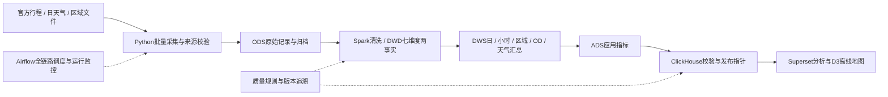

# 离线数仓架构与维度模型 v2.0

当前版：2026-11-03。架构图和可编辑原图位于 `diagrams/设计图预览.html`、`diagrams/城市出行数仓设计.drawio`。表和字段由 `tools/build_model.py` 生成，定义见 `05-物理表清单.md` 与 `数据字典.csv`。

Docker Compose启动五个服务。D盘目录承载Delta湖仓，Python和Spark完成离线采集与批量加工。Airflow串联采集、ODS/DWD验收、指标构建、图表检查、地图导出和运行监控。

## 事实与维度

七个维度：日期、日内分钟、区域、历史站点、交通方式、车型、日天气。事实分为：

| 事实表 | 一行代表什么 | 逻辑键 | 分区 |
| --- | --- | --- | --- |
| dwd.fact_taxi_trip | 一个通过核心规则的出租车源记录 | trip_key=ODS记录键 | 纽约开始日期service_date |
| dwd.fact_bike_trip | 一个无内容冲突的有效骑行 | ride_id | 纽约开始日期service_date |

两个业务过程共享日期、日内分钟、区域、交通方式和天气维度。起点/终点使用角色维度；不同粒度事实先分别汇总后比较，不能直接多对多连接。

历史站点采用“来源月份×历史站点编号”的期间快照维度，从真实骑行选最常见的名称与坐标组合，平票确定性选择，并保存冲突标志。此处的“快照”是历史维度组织方式，不是实时站点库存；事实保留真实起终点坐标。不宣称完整SCD2属性变更历史。

日期、分钟、区域、天气及站点都有明确未知成员，未知成员是模型元数据占位。日天气按气象站与观测日期关联，不据此推断小时天气或城市全部地点天气。

## 汇总与发布

DWS有trip_day、trip_hour、zone_hour、od_day、weather_group；ADS对应应用表并增加quality_batch和quality_rule。ODS保留原始对象、源位置、类型和内容，OPS保存批次、来源、质量与发布版本。

当前模型共28张逻辑表，27张有Delta存储，8张有ClickHouse存储，包含7张结果表与发布指针。应用表在两种存储中各有一份，数量不能直接相加。原实时表仍作为旧版本数据保存在磁盘供追溯，但已不在当前模型契约、字典或看板中。

共享原始层仍保留poll_id等旧版本兼容字段，以及旧数据来源的字段说明，以便读取原有Delta版本；这些字段不代表当前仍提供实时功能。离线历史加工不依赖GBFS接口、站点状态快照或Kafka。

历史ADS先校验再发布，Superset只读ads.bi_*视图。输入维度/质量表版本固定于已验证构建，后续元数据变更不自动改写历史解释。完整到达量和净流入在边界来源不完整时保持NULL。

## 2026-11-18建模与分层复核补充

逻辑公共模型层明确区分DIM公共维度与DWD明细事实；七个DIM的实际表名继续使用`dwd.dim_*`，不宣称已新增独立物理DIM数据库。两个事务事实各自为星型核心，共享一致性维度后整体为事实星座；站点→区域、天气→日期存在辅助维度引用，分析以事实直接引用为主。分层职责与保留物理名称的ADR见[分层复核](16-分层职责与指标口径复核.md)。

完整设计过程见[事实表四步设计](14-Kimball案例借鉴与事实表设计.md)、[总线矩阵与三类模型](15-业务总线矩阵与概念逻辑物理模型.md)、[生命周期与追溯示例](17-数仓开发生命周期与追溯示例.md)。新图位于`../outputs/2026-11-18-theme-definition-e721eb90/model/`。
