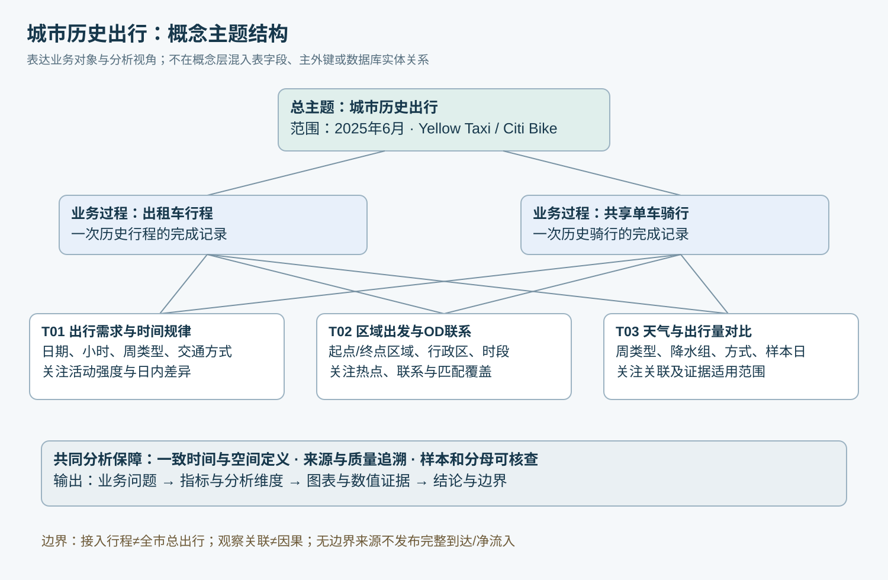
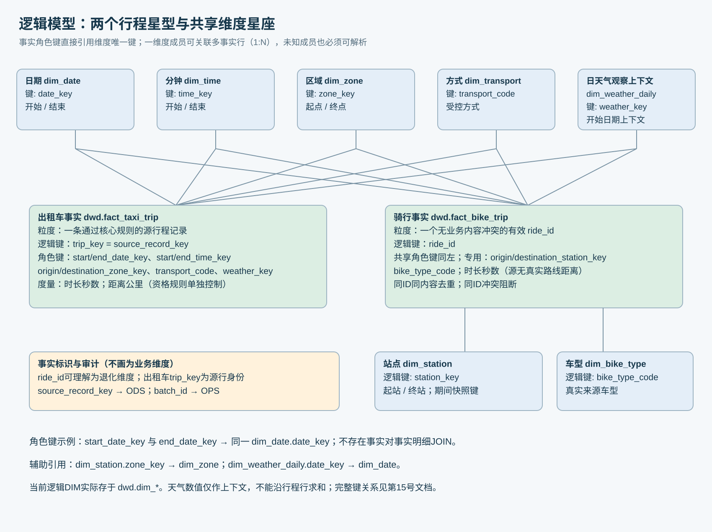
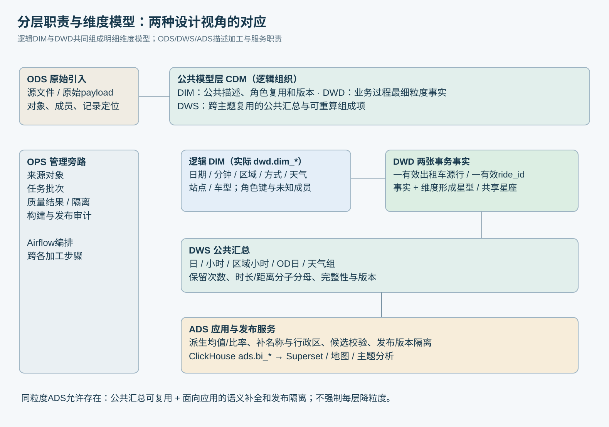

# 业务总线矩阵与概念、逻辑、物理模型

更新：2026-11-18。对应整改清单第3—5项。图见`../outputs/2026-11-18-theme-definition-e721eb90/model/`；与`config/model/schema-contract.json`逐字段核对。

## 1. 总线矩阵：从业务过程到共享维度

总主题为城市历史出行，业务域为出行活动域，业务过程为出租车行程与共享单车骑行。三个分析主题是时间规律、区域与OD、天气对比，并不要求一主题一事实。下面以业务过程为行、维度为列，表内说明维度角色；这是业务总线矩阵，不是表间ER关系图。[K3]

| 业务过程 | 日期 | 日内分钟 | 区域 | 历史站点 | 交通方式 | 车型 | 日天气 |
| --- | --- | --- | --- | --- | --- | --- | --- |
| 出租车行程 | 开始/结束 | 开始/结束 | 起点/终点 | — | taxi_yellow | — | 开始日期上下文 |
| 共享单车骑行 | 开始/结束 | 开始/结束 | 起点/终点 | 起站/终站 | citibike | 骑行车型 | 开始日期上下文 |

共同维度的语义要求：两方式均使用纽约当地日历、同一0—1439分钟编码、同一官方区域编码与边界、同一受控方式码、同一中央公园日观测来源及降水分组。事实版本固定到同一构建的维度快照，不能把后更新的维度偷偷套到旧结果。跨方式比较仅在这些共同定义、相同日期与空间子集下进行。

## 2. 概念结构：表达主题与分析视角

概念层以“城市历史出行”为中心，描述两个业务过程如何支撑三个分析主题，以及时间、地点/区域、方式、天气等分析视角。该图不画物理字段、主外键、数据库表或实体联系基数，满足本课程将概念分析结构与数据库ER表达区分的要求。这里不泛化成“任何数仓概念层都禁止ER图”的普遍结论。

主题下的具体业务问题及指标见已完成的`01-分析主题与业务问题定义.md`，共12问。本图负责说明分析对象和视角，不代替逻辑模型。

## 3. 逻辑结构：两个星型及整体事实星座

每个行程事实为中心，可分别展示自己的星型；整体两个事实通过一致性维度共享形成事实星座。开始/结束日期、分钟、起终区域与站点是同一维度的不同角色，不需要复制不同定义的维表。`dim_station.zone_key`和`dim_weather_daily.date_key`是维度组织与追溯的附加引用；星型分析以事实直接关联维度为主，不称整个模型完全无维度间关系。

事实—维度的实际逻辑引用如下。每个非空事实键应解析到一个维度成员；一个维度成员可被多条事实引用。未知成员允许解析，但不代表真实已知区域、站点或天气。

| 事实 | 角色键 | 目标维度 | 目标键 | 基数 |
| --- | --- | --- | --- | --- |
| dwd.fact_taxi_trip | start_date_key | dwd.dim_date | date_key | 多事实行→单维度成员（含未知成员） |
| dwd.fact_taxi_trip | end_date_key | dwd.dim_date | date_key | 多事实行→单维度成员（含未知成员） |
| dwd.fact_taxi_trip | start_time_key | dwd.dim_time | time_key | 多事实行→单维度成员（含未知成员） |
| dwd.fact_taxi_trip | end_time_key | dwd.dim_time | time_key | 多事实行→单维度成员（含未知成员） |
| dwd.fact_taxi_trip | transport_code | dwd.dim_transport | transport_code | 多事实行→单维度成员（含未知成员） |
| dwd.fact_taxi_trip | origin_zone_key | dwd.dim_zone | zone_key | 多事实行→单维度成员（含未知成员） |
| dwd.fact_taxi_trip | destination_zone_key | dwd.dim_zone | zone_key | 多事实行→单维度成员（含未知成员） |
| dwd.fact_taxi_trip | weather_key | dwd.dim_weather_daily | weather_key | 多事实行→单维度成员（含未知成员） |
| dwd.fact_bike_trip | start_date_key | dwd.dim_date | date_key | 多事实行→单维度成员（含未知成员） |
| dwd.fact_bike_trip | end_date_key | dwd.dim_date | date_key | 多事实行→单维度成员（含未知成员） |
| dwd.fact_bike_trip | start_time_key | dwd.dim_time | time_key | 多事实行→单维度成员（含未知成员） |
| dwd.fact_bike_trip | end_time_key | dwd.dim_time | time_key | 多事实行→单维度成员（含未知成员） |
| dwd.fact_bike_trip | transport_code | dwd.dim_transport | transport_code | 多事实行→单维度成员（含未知成员） |
| dwd.fact_bike_trip | origin_zone_key | dwd.dim_zone | zone_key | 多事实行→单维度成员（含未知成员） |
| dwd.fact_bike_trip | destination_zone_key | dwd.dim_zone | zone_key | 多事实行→单维度成员（含未知成员） |
| dwd.fact_bike_trip | weather_key | dwd.dim_weather_daily | weather_key | 多事实行→单维度成员（含未知成员） |
| dwd.fact_bike_trip | origin_station_key | dwd.dim_station | station_key | 多事实行→单维度成员（含未知成员） |
| dwd.fact_bike_trip | destination_station_key | dwd.dim_station | station_key | 多事实行→单维度成员（含未知成员） |
| dwd.fact_bike_trip | bike_type_code | dwd.dim_bike_type | bike_type_code | 多事实行→单维度成员（含未知成员） |

### 跨事实分析的正确做法

先按共同粒度分别聚合，再`UNION ALL`带方式标识的同口径结果，或在日×方式等唯一结果上比较。当前DWS作业选取两事实的共同字段后`unionByName`，再按日/小时等粒度聚合；不会按日期直接把数百万出租车行和数百万骑行行互相JOIN。事实间直接按日期/区域连接会成倍放大行数，是禁止的分析路径。

`ride_id`和出租车来源行键保留在事实；源站点编号、时间文本保留用于追溯。维度关联用规范角色键，不能用站名或中文方式名称建立松散关联。

## 4. 物理结构：实际存储与约束

| 实际表 | 一行的粒度 | 逻辑唯一键 | 分区 | 存储 |
| --- | --- | --- | --- | --- |
| dwd.dim_date | 一个公历日期；0是未知占位 | date_key | 不分区 | delta |
| dwd.dim_time | 一个当地分钟，共1440个；-1是未知 | time_key | 不分区 | delta |
| dwd.dim_zone | 一个官方区域编码或未知0 | zone_key | 不分区 | delta |
| dwd.dim_station | 命名空间×期间×来源站点业务键 | station_key | namespace | delta |
| dwd.dim_transport | 一个受控交通方式 | transport_code | 不分区 | delta |
| dwd.dim_bike_type | 一个来源车型代码 | bike_type_code | 不分区 | delta |
| dwd.dim_weather_daily | 气象站×源观测日期 | weather_key | 不分区 | delta |
| dwd.fact_taxi_trip | 一个通过核心规则的原始出租车记录 | trip_key | service_date | delta |
| dwd.fact_bike_trip | 一个规范化ride_id的一次有效骑行 | ride_id | service_date | delta |

字段类型、可空性和完整说明分别在`数据字典.csv`与`sql/spark/001_create_lakehouse.sql`中，均与模型契约生成。事实使用按纽约开始日期的分区，站点按namespace分区，小维度不强行分区。未知键包括日期/区域0、分钟-1及站点/天气UNKNOWN；具体域遵从契约，不把所有维度统一硬编码为0。

Delta提供版本与原子替换，质量任务实施逻辑唯一与引用校验；ClickHouse MergeTree的排序键不是主键唯一性约束。七个已发布ADS结果在ClickHouse服务，`ads.release_pointer`选择可读发布；BI只能读`ads.bi_*`视图，候选不能提前泄露。

## 5. 与分层架构的关系

分层回答数据在加工链路的职责；星型回答明细事实与维度如何组织。逻辑DIM和DWD共同构成明细维度模型，DWS是公共汇总，ADS是面向应用的结果与发布服务。逻辑层与物理schema不是一一强制对应：当前DIM实际位于`dwd.dim_*`，维度职责独立、版本共享，保留现有物理名的决策见第16号文档。

## 参考资料

- [K2] [Kimball Group: Grain](https://www.kimballgroup.com/data-warehouse-business-intelligence-resources/kimball-techniques/dimensional-modeling-techniques/grain/)，访问日期2026-11-18。
- [K3] [Kimball Group: Enterprise Data Warehouse Bus Matrix](https://www.kimballgroup.com/data-warehouse-business-intelligence-resources/kimball-techniques/enterprise-data-warehouse-bus-matrix/)，访问日期2026-11-18。
- [A1] [阿里云DataWorks：数仓分层](https://help.aliyun.com/zh/dataworks/user-guide/data-warehouse-layering)，访问日期2026-11-18。
- [A2] [阿里云DataWorks：维度建模](https://help.aliyun.com/zh/dataworks/user-guide/perform-dimensional-modeling)，访问日期2026-11-18。
