# 三个主题的数据分析结论

生成时间（UTC）：2026-11-18T09:58:21.460259+00:00；纽约当地数据期间：2025年6月。
发布版本：fa3ddf3a864140a7b6893836d3215a39。

## 依据与复现

本次读取已验证清单固定的Delta版本，通过完整JSON日志add/remove动作选取有效文件，未累加目录内无效旧文件。ADS按同一release_id过滤。完整区域和OD数据用于聚合，每份输入文件记录SHA-256。没有修改事实数据。

```powershell
python tools/build_theme_analysis.py --output "outputs/2026-11-18-theme-definition-e721eb90/analysis" --work "work/2026-11-18-theme-definition-e721eb90/analysis"
```

核对通过：日小时总量一致；区域总量对齐起点匹配数；完整OD总量对齐双端匹配数；归一化合计100%；各方式天气样本各30天；天气比率与发布指标一致。

## T01 出行需求与时间规律

### T01-Q01

黄色出租车共4,254,337条，日最高为2025-06-05（174,449条），最低为2025-06-30（110,861条）；共享单车共4,758,458条，日最高为2025-06-11（193,279条），最低为2025-06-14（88,458条）。高低值本身不能解释原因。

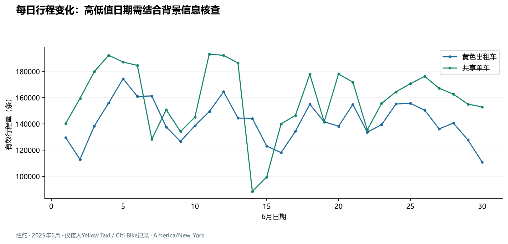

### T01-Q02

黄色出租车峰值为当地18时，小时日均9,956.9条；共享单车峰值为当地17时，小时日均14,757.7条。均以完整30天为分母。

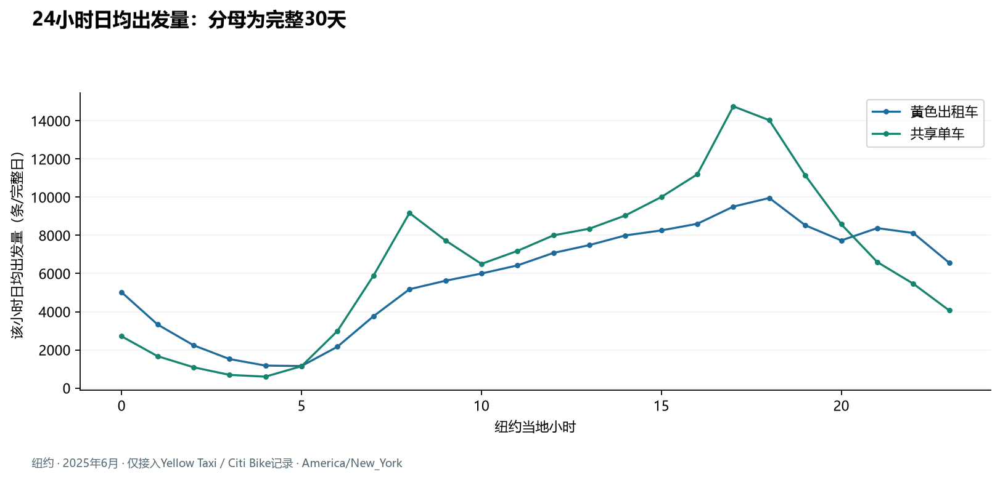

### T01-Q03

黄色出租车周一至周五21天日均142,925.2条，周末9天日均139,211.9条，周末相对前者-2.60%；两组小时峰值为18时、18时；共享单车周一至周五21天日均167,911.3条，周末9天日均136,924.6条，周末相对前者-18.45%；两组小时峰值为17时、17时。周一至周五没有剔除法定假日。

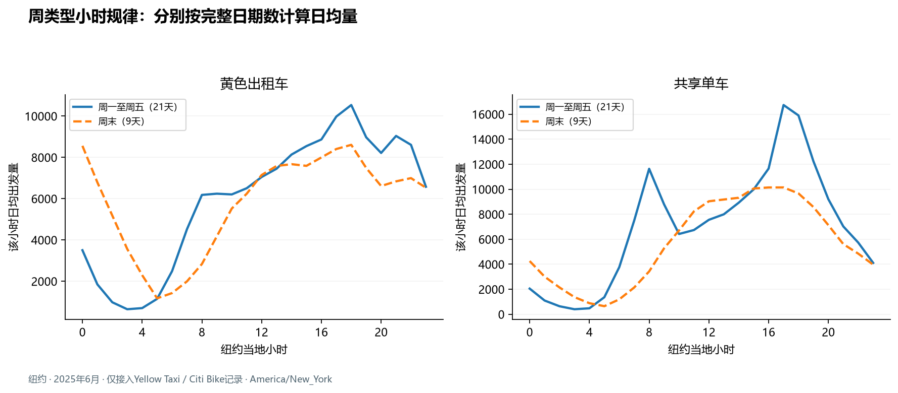

### T01-Q04

出租车平均时长17.67分钟（有效分母4,254,337条），骑行平均时长13.61分钟（有效分母4,758,458条）。出租车平均距离5.83公里（有效分母4,121,260条）；骑行真实距离不可用。均值从有效分子分母重新汇总，不能据此判断拥堵成因或出行效率。

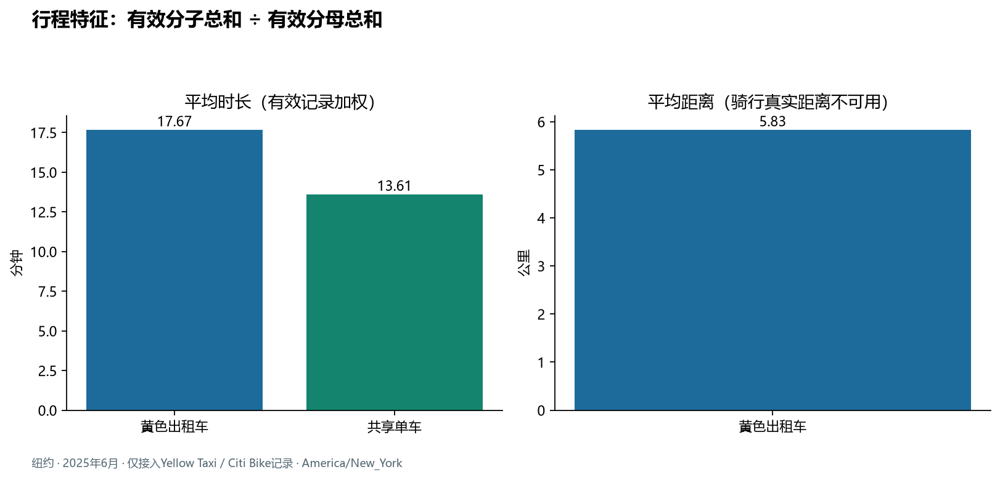

### T01-Q05

黄色出租车最活跃的18时占该方式月度行程7.02%；共享单车最活跃的17时占该方式月度行程9.30%。各方式24小时占比合计100%，不是全市交通方式分担率，也不证明两方式互相替代。

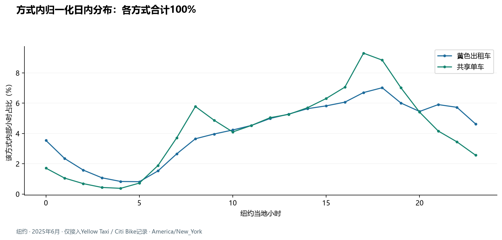

## T02 区域出发与OD联系

### T02-Q01

黄色出租车出发量最高区域为JFK Airport（Queens），月度185,935条；共享单车出发量最高区域为East Village（Manhattan），月度183,181条。完整Top15及行政区结果见CSV；只统计起点匹配记录，绝对量不是人口或面积标准化密度。

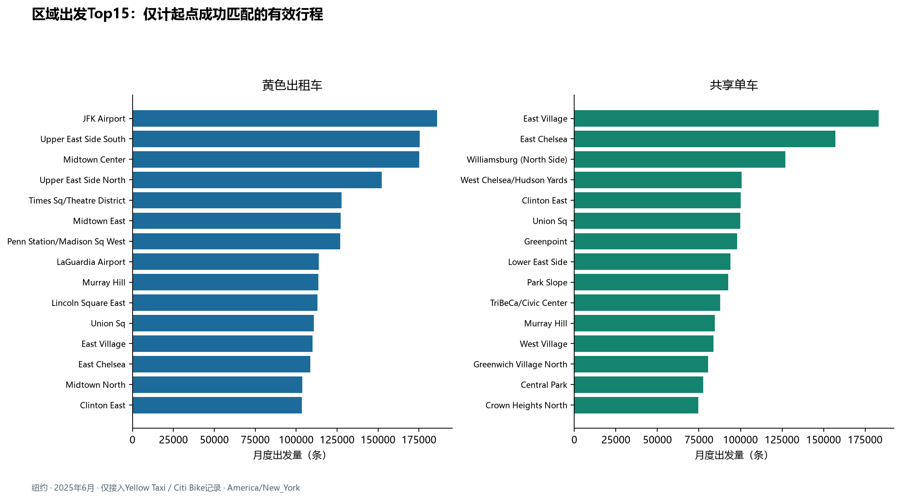

### T02-Q02

黄色出租车首位OD为Upper East Side South→Upper East Side North（23,947条），Top20共214,990条，占全部双端匹配OD 4,214,840条的5.10%；共享单车首位OD为East Village→East Village（38,956条），Top20共405,246条，占全部双端匹配OD 4,739,620条的8.55%。保留方向及同区OD；分母取完整OD表，不从Top20导出反推。

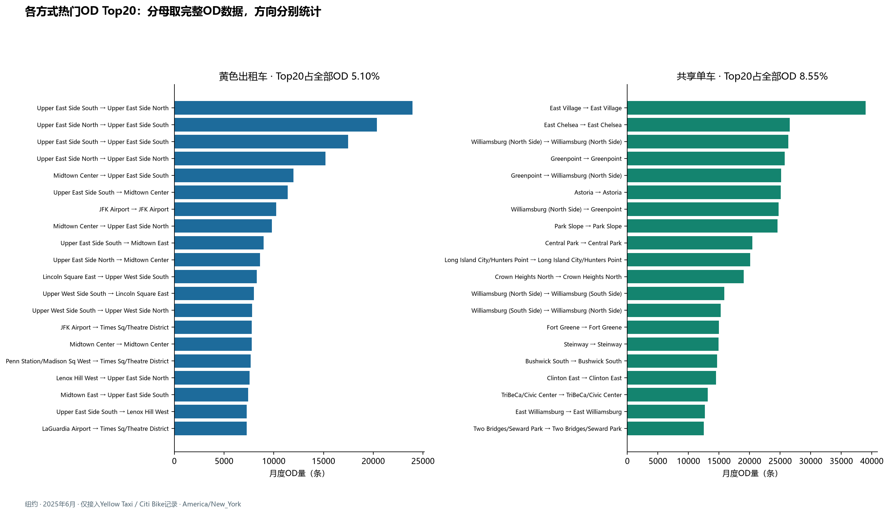

### T02-Q03

黄色出租车热点JFK Airport的峰值为当地16时，小时日均463.1条；同方式全部起点匹配区域峰值为18时；共享单车热点East Village的峰值为当地18时，小时日均483.9条；同方式全部起点匹配区域峰值为17时。图中比较绝对日均量与各自归一化形状；参照统一为起点匹配子集，不含到达或缺车判断。

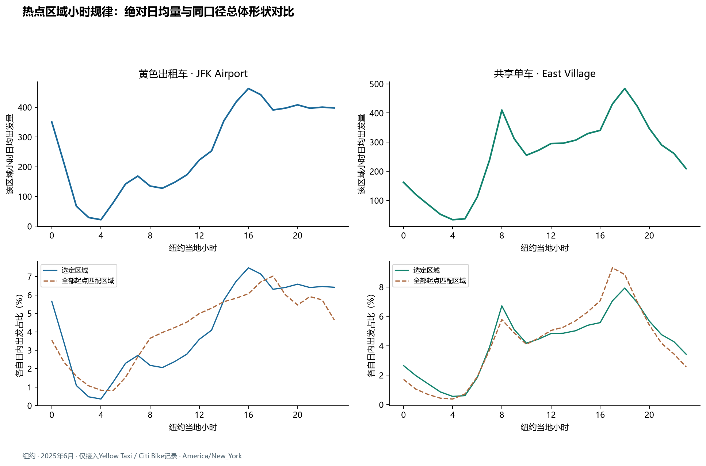

### T02-Q04

黄色出租车起点、终点、双端匹配率为99.79%、99.16%、99.07%；共享单车起点、终点、双端匹配率为99.96%、99.64%、99.60%。未匹配记录仍属于有效行程总量，空间结论只覆盖对应子集。

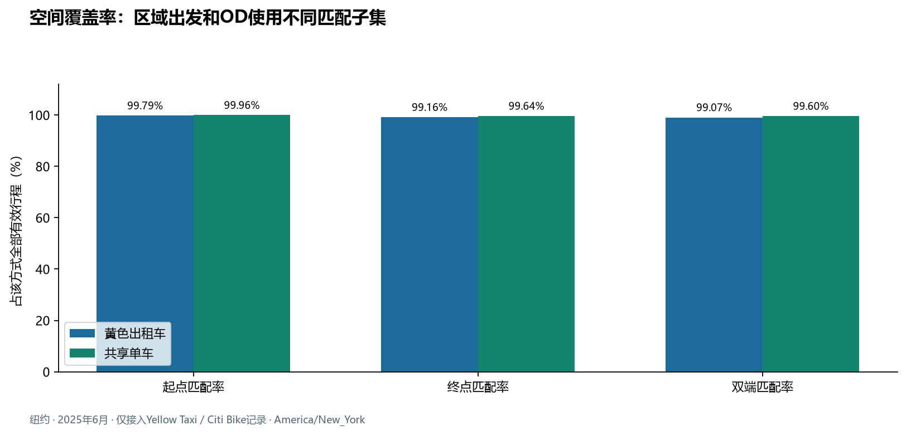

## T03 天气与出行量对比

### T03-Q01

黄色出租车周一至周五可测降水日均138,936.5条（8天），未记录可测降水组日均148,055.3条（11天）；黄色出租车周末可测降水日均140,566.6条（5天），未记录可测降水组日均137,448.7条（3天）；共享单车周一至周五可测降水日均154,636.0条（8天），未记录可测降水组日均178,168.8条（11天）；共享单车周末可测降水日均122,885.8条（5天），未记录可测降水组日均155,711.3条（3天）。微量降水另列。比较为单站日天气背景下的关联，不能由此断言天气导致改变。

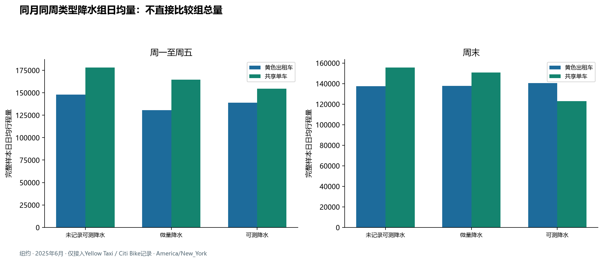

### T03-Q02

黄色出租车周一至周五可测降水比率0.938，相对基准-6.16%；黄色出租车周末可测降水比率1.023，相对基准+2.27%；共享单车周一至周五可测降水比率0.868，相对基准-13.21%；共享单车周末可测降水比率0.789，相对基准-21.08%。各项使用同方式同周类型的独立基准；日期因素和样本分布未被因果控制。

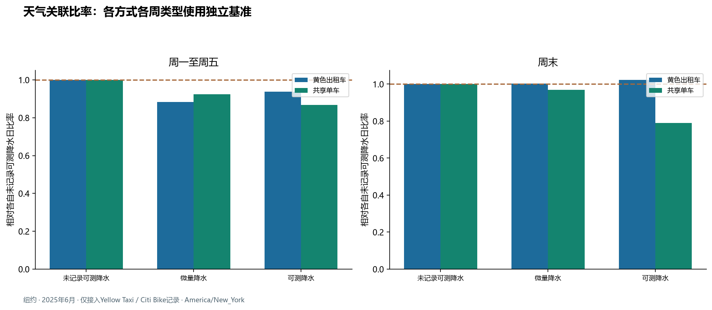

### T03-Q03

周一至周五：未记录可测降水11天、微量降水2天、可测降水8天；周末：未记录可测降水3天、微量降水1天、可测降水5天。两种方式共享这30个天气日期，不是60个独立样本。分组样本有限，仅作描述性对比，没有实施显著性检验。

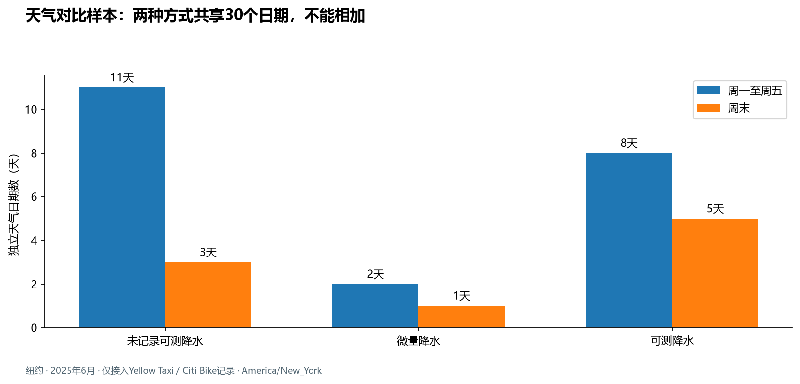

## 范围限制

- 仅描述六月两类接入行程，不代表全市全部出行或未满足需求。
- 周一至周五未剔除节假日；小时为America/New_York。
- 区域排名未按人口、面积或来源覆盖偏差标准化；OD按六月出发队列统计。
- 不发布完整到达量、净流入、库存、缺车或供需缺口结论。
- 天气是中央公园单站日级观测；无因果推断、显著性检验或预测。
- 这是固定历史发布的离线分析，不替代当前服务健康验收。

## 分析输出

- [index.html](index.html)
- [analysis-results.json](analysis-results.json)
