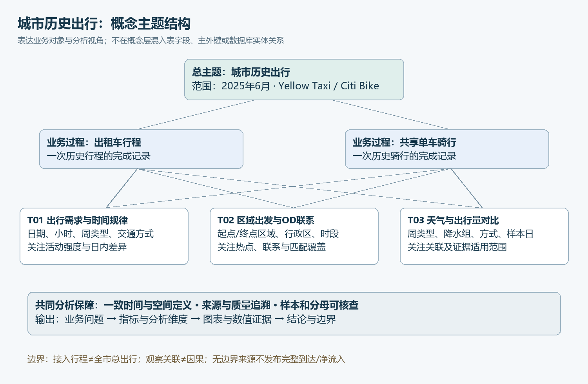
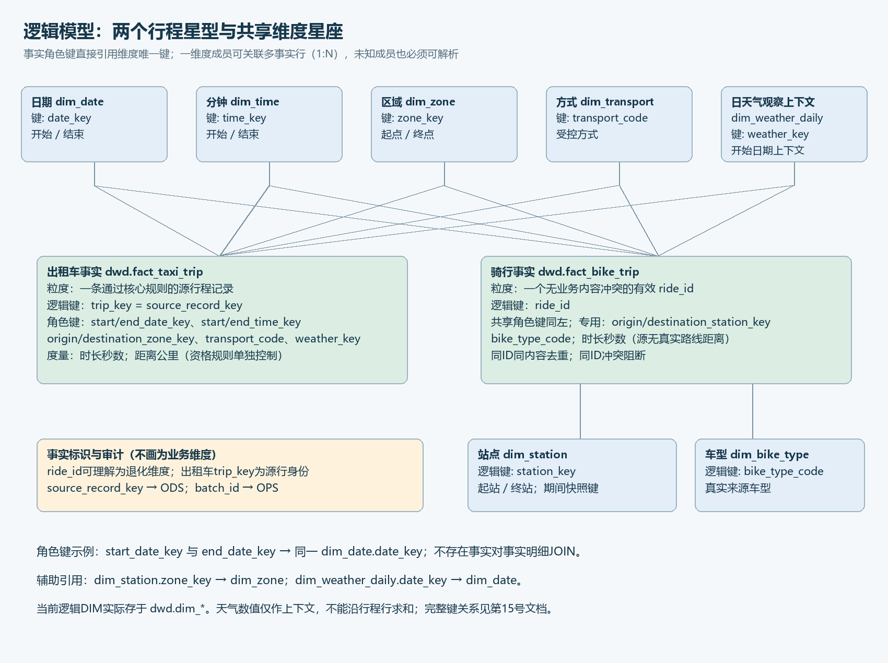
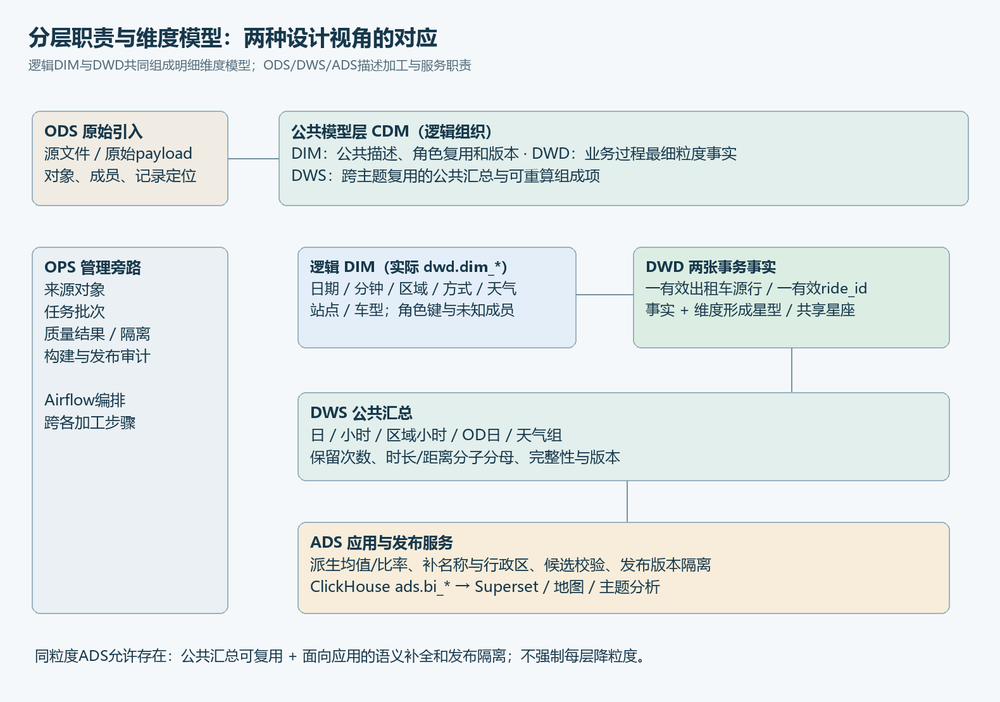
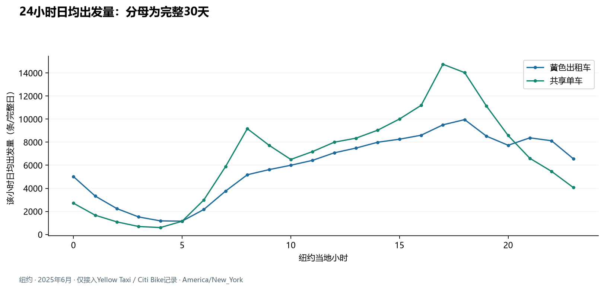
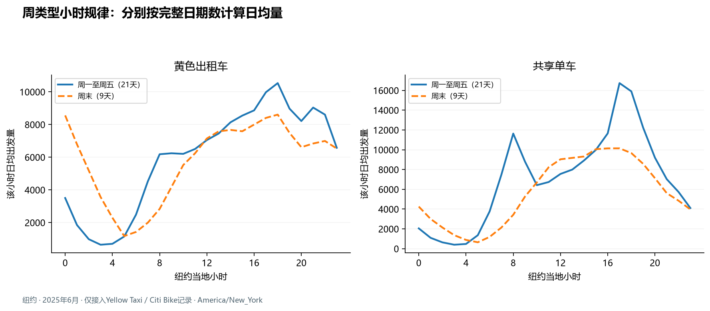
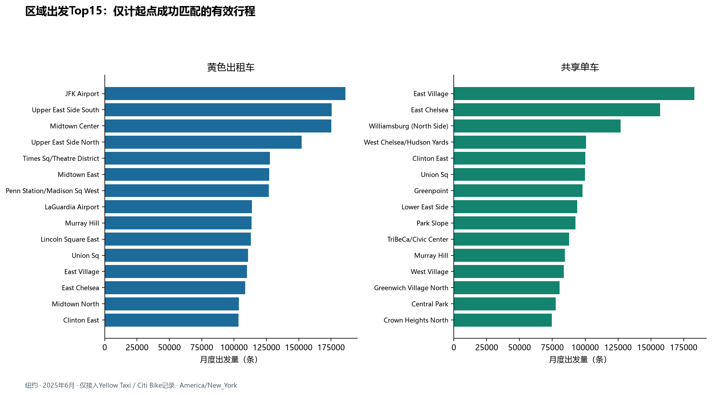
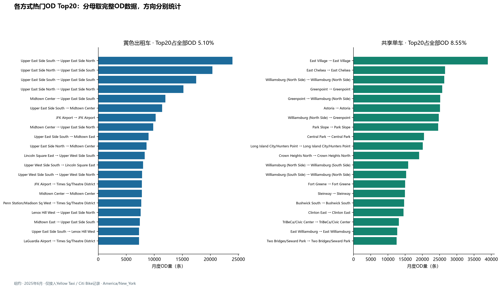
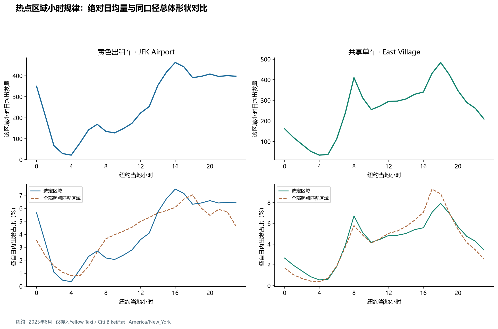
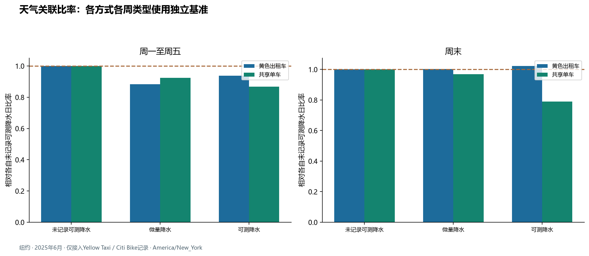

# 城市出行离线数据仓库系统的设计与实现

项目报告 · 2026年11月18日<br>
分析期间：2025年6月（纽约当地开始日期）<br>
数据范围：Yellow Taxi、Citi Bike、中央公园日天气与官方区域信息<br>
源码仓库：[yyyjjjj949/city-mobility-dw](https://github.com/yyyjjjj949/city-mobility-dw)

## 摘要

本项目面向城市历史出行分析，以纽约公开数据构建可追溯的离线数据仓库。系统通过Python采集官方文件，以Spark和Delta Lake完成原始入仓、明细清洗与公共汇总，使用ClickHouse提供已验证指标查询，并以Superset和离线地图展示结果。设计采用Kimball维度建模的业务过程、粒度、维度、事实四步法，参考阿里公共模型与分层复用思路，明确ODS、逻辑DIM/DWD、DWS、ADS及管理旁路OPS的职责。

当前已验证的完整月为2025年6月，共接收9,082,305条原始行程，得到9,012,795条有效行程，其中出租车4,254,337条、共享单车4,758,458条。两张事务事实共享日期、分钟、区域、交通方式及日天气上下文，骑行还使用站点与车型维度，形成两个行程星型及整体事实星座。本轮围绕三个分析主题落实12个业务问题，增加周类型对比、方式内小时占比、选定区域小时规律及OD集中度，并实施真实官方页面与公开目录解析。

分析显示，两类行程的观测小时峰值不同，出租车集中在当地18时，骑行集中在17时；热点区域与OD联系也呈现不同分布。天气比较按方式与周类型使用各自基准，并明确单站日观测、样本有限及非因果边界。本报告区分2026年11月14日历史验收与2026年11月18日本轮分析、模型及采集验证，并追加当日18:33后的安装登记修复、现场服务与调度恢复验收，不以旧记录替代现场检查。

**关键词**：离线数仓；维度建模；事实星座；公共汇总；出行分析；数据质量

## 1. 需求、分析主题与项目范围

### 1.1 使用场景与业务价值

预期使用者为城市交通分析人员、出租车与共享单车运营分析人员，以及课程评审人员。其主要需求是复盘历史出行活动、定位值得关注的日期和区域、比较两类方式的活动分布，并检查结论覆盖的数据范围。上述为需求设计角色，不表示已有真实机构访谈或生产部署。

总主题为“城市历史出行”。出租车行程、共享单车骑行是两个业务过程；分析主题围绕业务问题组织，可跨业务过程复用同一套事实与汇总，不要求一主题一事实或一主题一看板。

| 分析主题 | 业务问题 | 核心指标与分析视角 | 预期用途 |
| --- | --- | --- | --- |
| T01 出行需求与时间规律 | 每日量、小时峰值、周类型差异、时长/距离、方式内小时分布 | 行程量、小时日均量、平均时长、出租车平均距离、方式内小时占比 | 识别历史活动集中时段与结构差异 |
| T02 区域出发与OD联系 | 区域热点、热门OD及集中度、热点小时规律、空间覆盖率 | 区域出发量、OD量、Top20集中度、起终点/双端匹配率 | 复盘区域活动及区域联系，并解释空间子集 |
| T03 天气与出行量对比 | 降水组日均差异、相对独立基准变化、样本范围 | 分组日均量、需求比率、完整样本天数 | 描述天气背景关联，为后续研究提供线索 |

### 1.2 范围与限制

统计以纽约当地开始日期为准，当前只开放2025年6月。有效记录合计仅代表已接入的Yellow Taxi和Citi Bike行程，既不代表纽约全部出行，也不涵盖未实现的需求。日历中的周一至周五没有排除法定假日；骑行源没有真实行驶距离；天气为中央公园单站日级观察。缺五月边界来源时，完整六月事件到达量和净流入保持不可用，不以六月开始队列OD替代。

“离线”描述历史批次加工方式；数据获取可以联网，BI也可交互查询。项目已取消实时站点库存、Kafka链路、缺车预警和实时延迟目标。本轮交付按最新范围包括报告、代码/模型验证及GitHub同步，不制作PPT、录屏或新的运行包。

## 2. 数据来源与采集实现

### 2.1 来源和记录规模

| 来源 | 原始规模 | 当前使用方式 |
| --- | ---: | --- |
| TLC Yellow Taxi 2025-06 | 4,322,960条行程 | Parquet完整文件，保留源记录位置 |
| Citi Bike 202506 | 4,759,345条骑行 | ZIP内全部5个CSV，按逻辑CSV记录处理 |
| Taxi Zone编码 | 265条 | 包含官方特殊编码，分析选择可靠匹配的纽约区域 |
| NOAA中央公园日天气 | 30天 | 日温度、降水、风与质量标志 |
| Taxi Zone边界 | 完整Shapefile ZIP | 校验成员CRC，转换空间参考用于区域匹配 |

行程原始数9,082,305不包含辅助记录；ODS总记录9,082,600包含天气与区域编码，两个口径不能混用。原始行程经过规则处理后，有效9,012,795条、隔离68,604条、范围外906条，合计与原始行程数一致。

### 2.2 本轮爬取增强

原实现为固定官方地址的程序化下载。本轮新增`tools/discover_sources.py`：请求TLC历史数据网页，以HTMLParser提取真实`a[href]`并精确选择目标月份Parquet；请求Citi Bike系统数据页面，发现官方tripdata目录，再解析其公开XML对象列表定位目标月份ZIP。发现URL与已验证来源清单精确比较，骑行对象大小也核对；不将任意外站或相似文件名当作可信来源。

2026年11月18日真实联网发现成功：出租车定位`yellow_tripdata_2025-06.parquet`；骑行定位`202506-citibike-tripdata.zip`，对象大小929,043,436字节，与已登记来源一致。天气仍是官方API JSON采集，区域基础数据仍是官方文件下载，不将这些统一标成HTML爬虫。

新增文件首次获取先爬取目录，发现失败即停止；已下载且来源URL、大小、SHA一致的文件可以离线复用。主动演示`--discover-only`仅发现来源，不重新下载大文件。爬虫遵守robots规则、官方HTTPS主机约束、串行限速、超时、有限重试、重定向和XML分页上限；原始响应保存在本地work，公开回执保留请求元数据与内容SHA。

## 3. 维度建模方法与事实设计

### 3.1 Kimball方法的应用

采用Kimball四步决策顺序：先选业务过程，再声明“一行代表什么”，随后识别维度与事实。[1][2] 运输行业案例启发本项目区分行程事件、出发/到达时间与地点角色，不复制航空业票券、旅客、航段或收入字段。课程指定教材及课件未作为完整附件提供，因此本文引用可核验的官方方法资料，不虚构已通读教材、章节页码或课程访谈。

| 设计步骤 | 出租车行程 | 共享单车骑行 |
| --- | --- | --- |
| 业务过程 | 一次历史出租车完成记录 | 一次历史骑行完成记录 |
| 粒度 | 一条通过核心校验、属于目标开始日期窗口的源记录 | 一个有效且无业务内容冲突的ride_id |
| 逻辑唯一键 | trip_key等于ODS源记录键 | ride_id |
| 共同维度 | 开始/结束日期、分钟，起终区域，交通方式，开始日天气上下文 | 同左 |
| 专用维度 | 当前无新增专用维度 | 起站/终站、车型 |
| 事实与度量 | 隐含计数1、有效时长、合格出租车距离 | 隐含计数1、有效时长；无真实骑行距离 |
| 追溯 | source_record_key、batch_id、rule_version | 同左并保留ride_id |

出租车源没有可验证的全局业务ID，`trip_key`证明来源行身份；相同内容不同源位置不能自动判为同一事件删除。骑行同ID同内容去重，同ID业务内容冲突阻断发布。`ride_id`可作为退化维度理解；出租车源行键主要承担来源追溯。

### 3.2 业务总线矩阵与一致性维度

业务总线矩阵以业务过程为行、维度为列，表达哪些描述视角可以跨过程复用。[3]

| 业务过程 | 日期 | 分钟 | 区域 | 历史站点 | 交通方式 | 车型 | 日天气 |
| --- | --- | --- | --- | --- | --- | --- | --- |
| 出租车行程 | 开始/结束 | 开始/结束 | 起点/终点 | 不适用 | taxi_yellow | 不适用 | 开始日上下文 |
| 共享单车骑行 | 开始/结束 | 开始/结束 | 起点/终点 | 起站/终站 | citibike | 来源车型 | 开始日上下文 |

两个过程使用同一日历、分钟编码、官方区域与边界、受控方式码和天气分组。起点/终点、开始/结束是同一维度的角色；站点采用来源月份期间快照，不把当前容量倒填历史，不声称完整SCD2变更历史。未知成员使引用可解析，但不把未知解释成真实地点或天气。

### 3.3 概念、逻辑和物理结构

概念结构表达总主题、业务过程和分析视角，不在课程概念图中混入数据库字段与主外键。



逻辑结构明确两张事务事实、七个维度、角色键及一维度成员对多事实行的关系。每个事实可视为一个星型核心，整体共享维度形成事实星座。站点→区域、天气→日期存在辅助维度引用，分析仍以事实直接引用为主，不宣称整个模型没有维度间关系。



物理结构由`schema-contract.json`、DDL及数据字典定义。两事实按纽约开始日期`service_date`分区，站点按`namespace`分区，小维度不强行分区；逻辑唯一键与引用完整性通过质量任务实施，不把Delta或ClickHouse排序键说成强制外键。实际明细包含出租车48列、骑行39列，保留必要源字段和审计信息。

### 3.4 度量可加性与天气上下文

行程次数、合格时长之和、合格出租车距离之和在同一粒度及资格规则下可加；均值、比例、比率需由组成项重新计算，不能跨日平均每日均值。[4] 天气样本天数只在固定方式内对不重叠组相加，同一日跨两方式不成为两个独立天气样本。

`dim_weather_daily`包含日测量数值，但当前作为行程开始日的分析上下文，使用其分组而不沿行程行累加温度或降水。若扩展独立气象分析，应建立站点×观察时刻粒度的天气观测事实并规定时空关联。当前不存在库存余额等半可加事实，不为术语展示虚构库存模型。

## 4. 分层设计与技术架构

### 4.1 分层职责及实际映射

参考阿里DataWorks公开方法，公共模型可区分DIM、DWD、DWS，ODS负责数据引入，ADS负责应用组织。[5][6] 官方维度建模资料明确说明其中数据域示意引用《大数据之路》，本文据此交叉核对分层思想，不宣称直接复刻该书全部方法。



| 逻辑层 | 当前实际对象 | 主要职责 |
| --- | --- | --- |
| ODS | 原始文件、ods.source_record | 原始payload、来源位置和重放 |
| DIM | 物理dwd.dim_*七维度 | 统一描述、角色复用、未知成员与历史解释 |
| DWD | 两张dwd.fact_* | 清洗后的事务粒度事实、资格与追溯键 |
| DWS | 日、小时、区域小时、OD日、天气组五公共汇总 | 次数、分子/分母、完整性及跨主题复用 |
| ADS | 七结果表、ClickHouse副本、bi视图 | 派生指标、语义补全、看板服务及版本隔离 |
| OPS | 来源、批次、质量、隔离、发布记录 | 贯穿链路的管理旁路 |

ADR-001保留物理`dwd.dim_*`，独立明确逻辑DIM职责。当前已有版本、质量与构建引用这些稳定身份，仅为前缀迁移没有业务收益；报告不宣称已新增物理DIM数据库。若未来确需拆分，应版本化迁移并重新验证。

ADR-002允许DWS与部分ADS同业务粒度：DWS保存公共可重算组成项，ADS补均值/比率、名称/行政区及发布版本。区域小时汇总同时支持地图、排行和热点曲线；完整OD汇总同时支持Top20、集中度与矩阵。质量ADS直接来自OPS合理，不强行为每个应用复制一张DWS。

### 4.2 组件职责

Python处理官方采集与轻量分析；Spark/Delta Lake承载批处理、分区与固定版本；ClickHouse提供发布后查询；Superset承载四个看板与19张图；D3地图提供日期、方式和区域交互；Airflow组织十步依赖；PostgreSQL保存调度和BI元数据。部署使用Docker Compose，当前设计为单机课程规模，不宣称分布式生产吞吐或多机高可用。

## 5. 加工、质量与指标实现

### 5.1 ODS至明细层

原文件完成长度、SHA和格式内部检查后，按对象、成员与逻辑记录位置建立原始身份。ODS按完整来源/月分区校验后替换；DWD解析纽约当地时间并保存UTC，夏令时歧义或不存在的时间按规则处理，检查结束早于开始、时长范围、身份冲突和空间匹配。输入去向区分有效、隔离、重复跳过及范围外，规则不得因作业失败而放宽。

核心有效行程可有空间未知或不合格距离：它仍参与时间总量，但不进入对应空间或距离子集。隔离记录保留源位置与原因；一个记录可触发多条原因，因此原因明细行数不能代替隔离原记录数。

### 5.2 公共汇总与关键口径

两个事实选取共同字段后`UNION ALL`，再按日/小时等统一粒度汇总；不按日期直接JOIN两张明细事实，避免多对多放大。

| 指标 | 聚合约定 |
| --- | --- |
| 平均时长 | SUM有效时长秒数÷SUM对应有效记录数÷60 |
| 出租车平均距离 | SUM合格公里数÷SUM对应距离记录数；骑行NULL |
| 小时日均量 | 该当地小时行程总量÷选中来源完整日期数；完整零日也入分母 |
| 周类型日均量 | 同方式同周类型总量÷该组完整天数 |
| 方式内小时占比 | 某方式某小时量÷同方式同日期范围总量 |
| 区域出发量 | 仅起点成功匹配行程，按区域/小时/方式汇总 |
| OD与集中度 | 双端匹配开始队列；Top20量÷同范围全部OD量，保留方向及同区OD |
| 空间匹配率 | 起点/终点/双端各自匹配计数之和÷全部有效行程数之和 |
| 天气日均与比率 | 同月/方式/周类型/降水组总量÷天数，再除本方式本周类型基准日均 |

无样本、零分母、未知或边界不完整保持NULL；来源完整且确无行程时才为0。天气分组的无可测降水不等于晴天，微量降水独立展示。

### 5.3 发布与筛选

构建固定ODS/DWD、维度和规则版本。DWS按目标月覆盖；ADS候选以`release_id`隔离，ClickHouse核对行数、逻辑键及完整内容摘要后切换发布指针，失败保留旧可读结果。BI读取`ads.bi_*`，不直接读候选。

日期和方式筛选使用相同范围；行政区筛选只作用于对应区域出发图，不自动改变OD排行及全局覆盖率。现有天气分组按完整六月聚合，任意日期片段需回到日级重新聚合，不能只过滤月结果。批次质量指标按来源/批次查看，不直接套行程日期与区域分母。

## 6. 三个主题与十二个业务问题的分析结果

本轮分析读取已验证清单固定的Delta版本，按照JSON日志add/remove选择当前有效文件，ADS限定同一发布版本`fa3ddf3a864140a7b6893836d3215a39`；不累加目录中的历史无效文件。输入文件SHA与选定版本记录在来源回执，结果可由`tools/build_theme_analysis.py`重建。以下数值均来自本轮实际计算。

### T01 出行需求与时间规律

### T01-Q01 每日变化与高低值日期

黄色出租车共4,254,337条，日最高为2025-06-05（174,449条），最低为2025-06-30（110,861条）；共享单车共4,758,458条，日最高为2025-06-11（193,279条），最低为2025-06-14（88,458条）。高低值本身不能解释原因。
### T01-Q02 当地小时分布与观测峰值

黄色出租车峰值为当地18时，小时日均9,956.9条；共享单车峰值为当地17时，小时日均14,757.7条。均以完整30天为分母。


### T01-Q03 周一至周五与周末的差异

黄色出租车周一至周五21天日均142,925.2条，周末9天日均139,211.9条，周末相对前者-2.60%；两组小时峰值为18时、18时；共享单车周一至周五21天日均167,911.3条，周末9天日均136,924.6条，周末相对前者-18.45%；两组小时峰值为17时、17时。周一至周五没有剔除法定假日。


### T01-Q04 时长与出租车距离特征

出租车平均时长17.67分钟（有效分母4,254,337条），骑行平均时长13.61分钟（有效分母4,758,458条）。出租车平均距离5.83公里（有效分母4,121,260条）；骑行真实距离不可用。均值从有效分子分母重新汇总，不能据此判断拥堵成因或出行效率。
### T01-Q05 方式内部的归一化小时分布

黄色出租车最活跃的18时占该方式月度行程7.02%；共享单车最活跃的17时占该方式月度行程9.30%。各方式24小时占比合计100%，不是全市交通方式分担率，也不证明两方式互相替代。


T01的业务含义是：两类活动的峰值及周类型差异值得分别复盘，不能以单一“全市高峰”代替。时长与距离只描述已发生行程的特征，不足以解释交通拥堵、通勤目的或运营效率。

### T02 区域出发与OD联系

### T02-Q01 区域出发热点

黄色出租车出发量最高区域为JFK Airport（Queens），月度185,935条；共享单车出发量最高区域为East Village（Manhattan），月度183,181条。完整Top15及行政区结果见CSV；只统计起点匹配记录，绝对量不是人口或面积标准化密度。


### T02-Q02 热门OD与集中度

黄色出租车首位OD为Upper East Side South→Upper East Side North（23,947条），Top20共214,990条，占全部双端匹配OD 4,214,840条的5.10%；共享单车首位OD为East Village→East Village（38,956条），Top20共405,246条，占全部双端匹配OD 4,739,620条的8.55%。保留方向及同区OD；分母取完整OD表，不从Top20导出反推。


### T02-Q03 热点区域的小时规律

黄色出租车热点JFK Airport的峰值为当地16时，小时日均463.1条；同方式全部起点匹配区域峰值为18时；共享单车热点East Village的峰值为当地18时，小时日均483.9条；同方式全部起点匹配区域峰值为17时。图中比较绝对日均量与各自归一化形状；参照统一为起点匹配子集，不含到达或缺车判断。


### T02-Q04 空间匹配覆盖范围

黄色出租车起点、终点、双端匹配率为99.79%、99.16%、99.07%；共享单车起点、终点、双端匹配率为99.96%、99.64%、99.60%。未匹配记录仍属于有效行程总量，空间结论只覆盖对应子集。


T02的业务含义是：不同方式的重点区域和区域联系不同，区域时段也可能偏离总体峰值。它们为后续调查提供线索，但没有人口、面积、可用车辆与未满足需求等数据，不能直接据此得出密度、供给不足或运力调度数量。

### T03 天气与出行量对比

### T03-Q01 降水组日均量

黄色出租车周一至周五可测降水日均138,936.5条（8天），未记录可测降水组日均148,055.3条（11天）；黄色出租车周末可测降水日均140,566.6条（5天），未记录可测降水组日均137,448.7条（3天）；共享单车周一至周五可测降水日均154,636.0条（8天），未记录可测降水组日均178,168.8条（11天）；共享单车周末可测降水日均122,885.8条（5天），未记录可测降水组日均155,711.3条（3天）。微量降水另列。比较为单站日天气背景下的关联，不能由此断言天气导致改变。
### T03-Q02 相对独立基准的变化幅度

黄色出租车周一至周五可测降水比率0.938，相对基准-6.16%；黄色出租车周末可测降水比率1.023，相对基准+2.27%；共享单车周一至周五可测降水比率0.868，相对基准-13.21%；共享单车周末可测降水比率0.789，相对基准-21.08%。各项使用同方式同周类型的独立基准；日期因素和样本分布未被因果控制。


### T03-Q03 天气样本与解读限制

周一至周五：未记录可测降水11天、微量降水2天、可测降水8天；周末：未记录可测降水3天、微量降水1天、可测降水5天。两种方式共享这30个天气日期，不是60个独立样本。分组样本有限，仅作描述性对比，没有实施显著性检验。


T03的业务含义是：在同一方式与周类型内，相对基准比较能降低原始规模及组天数不同带来的误读；出租车周末甚至呈小幅正差异，说明不能预设“降水必然使所有方式减少”的统一结论。日期、假期和其他因素没有被因果控制，现有结果只作描述性关联。

## 7. 生命周期、调度与追溯

开发过程从业务问题出发，经数据调研、事实粒度、共享维度、分层及物理实现、采集清洗、汇总发布，最终形成分析证据与边界。当前资料完整列出这些产物之间的对应关系，不把先有数据表再补名称当作完整需求分析。

以T01-Q02为例：官方源对象及SHA → ODS对象/成员/序号 → DWD有效行程及开始UTC小时 → DWS小时公共汇总与完整骨架 → ADS发布版本与方式名称 → 已验证BI视图 → 当地小时日均图 → 18时与17时的观测峰值及30天分母说明。任一步都可沿来源记录键、批次及固定版本回查。

Airflow链路为采集、ODS验收、DWD构建、DWD验收、指标构建、看板注册、图表验收、地图导出、预览导出、项目检查，共十步。运行环境可用时按北京时间02:00调度，当前月份参数限定2025-06；失败阻断下游并保留日志，重试一次。关机/休眠不执行，`catchup=False`不自动补齐全部停机计划。

## 8. 验证结果与当前环境状态

### 8.1 本轮验证与历史证据分开

| 证据类别 | 日期与结论 | 解释范围 |
| --- | --- | --- |
| 模型结构核查 | 2026-11-18：16项核查通过，25个DWD引用目标与类型核对通过 | 契约、AST、角色、组成项、文档和图的一致性 |
| 模型退化回归 | 2026-11-18：5个测试通过 | 能拒绝错类型、错角色、丢失均值分母和不完整到达被误标完整 |
| 主题分析验证 | 2026-11-18：两方式各6项对账通过 | 日小时量、空间子集、完整OD、归一化、天气天数及行程量 |
| 主题分析回归 | 2026-11-18：8项测试通过 | 分母、重复文件/日志选择和相关边界，详见测试回执 |
| 采集与集成回归 | 2026-11-18：包含15项爬取回归；全套35项测试通过 | 7项已有基线＋15项爬取＋5项模型＋8项分析 |
| DWD重新审计 | 2026-11-18：78个已提交Parquet文件核查通过，9,012,795条有效行程时长及UTC差值检查通过，120条原始来源抽样追溯通过 | 对本地已固定快照的重新验收，不依赖运行服务 |
| 官方目录爬取 | 2026-11-18：TLC与Citi Bike实际联网发现成功 | 发现链接与登记对象匹配；未重复下载全部源文件 |
| 历史运行验收 | 2026-11-14：地图、筛选、两次全流程、失败阻断、重启及15分钟46次探测记录 | 仅证明当时所测结果，不证明当前服务健康、多日稳定或断电恢复 |
| Docker与服务恢复 | 2026-11-18：18:33恢复AppPath，18:35的12项现场检查通过 | 引擎、五个服务、实际行程查询、发布指针、BI登录和调度健康 |
| 十步调度恢复 | 2026-11-18：18:34:15—18:36:48，排队计划实例十步均成功 | DWD/指标复用原已验证构建；没有强制重算或新增多日稳定性测试 |

本轮初次复核时，Docker因Windows系统级安装登记缺失而不能启动。2026年11月18日18:33，在用户通过正常UAC授权后，仅恢复已有D盘安装的AppPath；18:35完成12项现场服务检查，原9,012,795条已发布行程、版本指针、4个看板与19张图表保留。恢复后处理的计划实例于18:34—18:36完成十步链路，DWD和指标幂等复用已验证构建。该实例ID内的11月14日日期为计划标识，其任务实际执行时间均在11月18日；没有强制重新全量计算、卸载或清空数据。本轮服务恢复和2026年11月14日历史故障/稳定性验收分别记录，详见[恢复说明](../../../docs/21-Docker安装登记恢复与验收.md)。

本轮测试与采集回执见交付目录对应JSON；最终集成结果见`outputs/2026-11-18-theme-definition-e721eb90/verification/整改验证.json`，以仓库提交中实际记录为准。本报告不预先填写未执行的服务通过项。

### 8.2 教师检查问题与整改对应

| 检查事项 | 已形成的整改产物 |
| --- | --- |
| 主题分析不足 | 3主题12问、数值结论、12组分析图和可复查来源 |
| 事实表设计无章法 | 两事实四步设计、身份与粒度、度量可加性与资格规则 |
| 概念/逻辑表达混淆 | 总线矩阵、概念主题图、逻辑星座图、物理字段/分区映射 |
| 星型与分层关系不清 | 逻辑DIM说明、分层对应图与两项ADR |
| 尽量爬取数据 | 官方HTML与XML目录实际解析，首次获取集成和有限访问策略 |
| 数仓开发流程需核查 | 需求到分析生命周期与两个指标追溯示例 |
| 交付不一致 | 正式报告、公开可复现工具、测试与GitHub同步；不包含PPT/录屏/新运行包 |

## 9. 复现、交付与后续扩展

安装项目复核依赖后，可在项目根依次运行以下命令。原始大数据和本机凭据不纳入公开仓库，完整主题结果已导出，查看报告、图与CSV不要求先启动服务；重新计算需要本地已有的对应源快照和构建清单。

```powershell
python tools/verify_model_design.py --output-dir outputs/2026-11-18-theme-definition-e721eb90/model
python -m unittest discover -s tests -v
python tools/discover_sources.py --month 2025-06 --source all
python tools/build_theme_analysis.py --output outputs/2026-11-18-theme-definition-e721eb90/analysis --work work/2026-11-18-theme-definition-e721eb90/analysis
python tools/build_project_report.py
```

GitHub仓库为本报告首页所列地址，最终文件状态以提交后的实际commit为准。公开范围包括源码、DDL、数据字典、方法说明、图、分析结果和验证回执，排除真实账号凭据、数据库备份、镜像与完整原始大文件。后续可按需求扩月、补相邻月边界、接入可靠假日日历及多站天气，但每次扩展都应更新粒度、时间骨架、源完整性和回归验收，不能把当前脚本参数视为已验证任意月份。

## 参考资料与项目内依据

1. Kimball Group. [Four-Step Dimensional Design Process](https://www.kimballgroup.com/data-warehouse-business-intelligence-resources/kimball-techniques/dimensional-modeling-techniques/four-4-step-design-process/). 访问日期：2026-11-18。
2. Kimball Group. [Grain](https://www.kimballgroup.com/data-warehouse-business-intelligence-resources/kimball-techniques/dimensional-modeling-techniques/grain/). 访问日期：2026-11-18。
3. Kimball Group. [Enterprise Data Warehouse Bus Matrix](https://www.kimballgroup.com/data-warehouse-business-intelligence-resources/kimball-techniques/enterprise-data-warehouse-bus-matrix/). 访问日期：2026-11-18。
4. Kimball Group. [Additive, Semi-Additive, and Non-Additive Facts](https://www.kimballgroup.com/data-warehouse-business-intelligence-resources/kimball-techniques/dimensional-modeling-techniques/additive-semi-additive-non-additive-fact/). 访问日期：2026-11-18。
5. 阿里云DataWorks. [数仓分层](https://help.aliyun.com/zh/dataworks/user-guide/data-warehouse-layering). 访问日期：2026-11-18。
6. 阿里云DataWorks. [维度建模](https://help.aliyun.com/zh/dataworks/user-guide/perform-dimensional-modeling). 访问日期：2026-11-18；其中数据域示意引用《大数据之路：阿里巴巴大数据实践》。

项目依据：[主题定义](../01-分析主题与业务问题定义.md)、[四步设计](../../../docs/14-Kimball案例借鉴与事实表设计.md)、[模型与矩阵](../../../docs/15-业务总线矩阵与概念逻辑物理模型.md)、[分层与指标](../../../docs/16-分层职责与指标口径复核.md)、[生命周期](../../../docs/17-数仓开发生命周期与追溯示例.md)、[12问分析](../../../docs/18-三个主题的数据分析结论.md)、[爬取说明](../../../docs/19-官方数据爬取与采集说明.md)。

数值与复核依据：[分析结果](../analysis/analysis-results.json)、[来源版本与SHA](../analysis/source-provenance.json)、[模型核对](../model/model-design-review.json)、[参考来源回执](../model/reference-manifest.json)、[爬取回执](../crawl/latest.json)、[历史验收](../../offline-verification.json)。

恢复补充依据：[现场服务验收](../verification/docker-environment-repair.json)、[十步调度恢复](../verification/docker-pipeline-recovery.json)。
